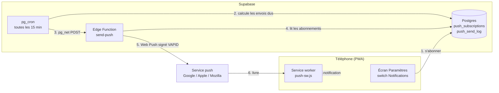
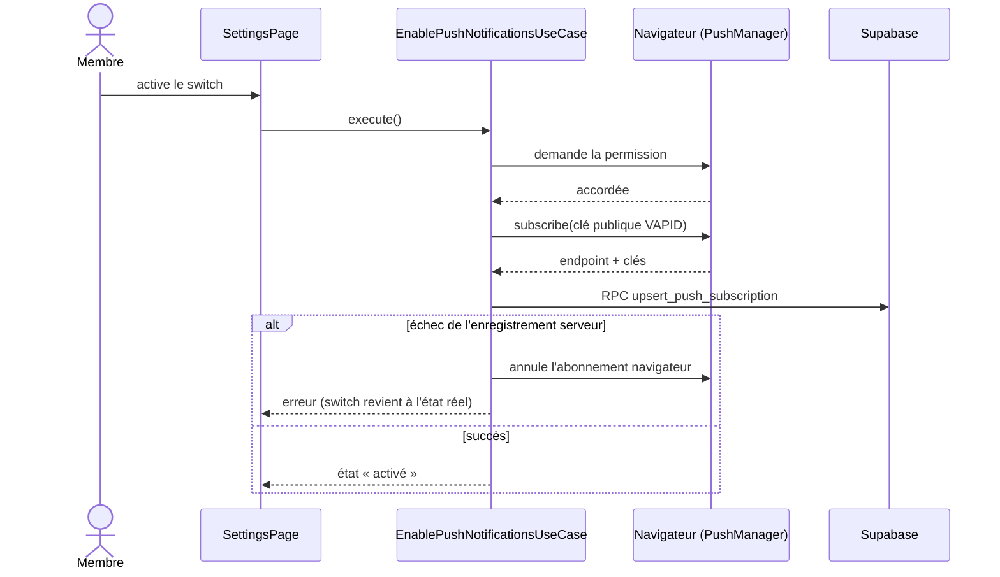
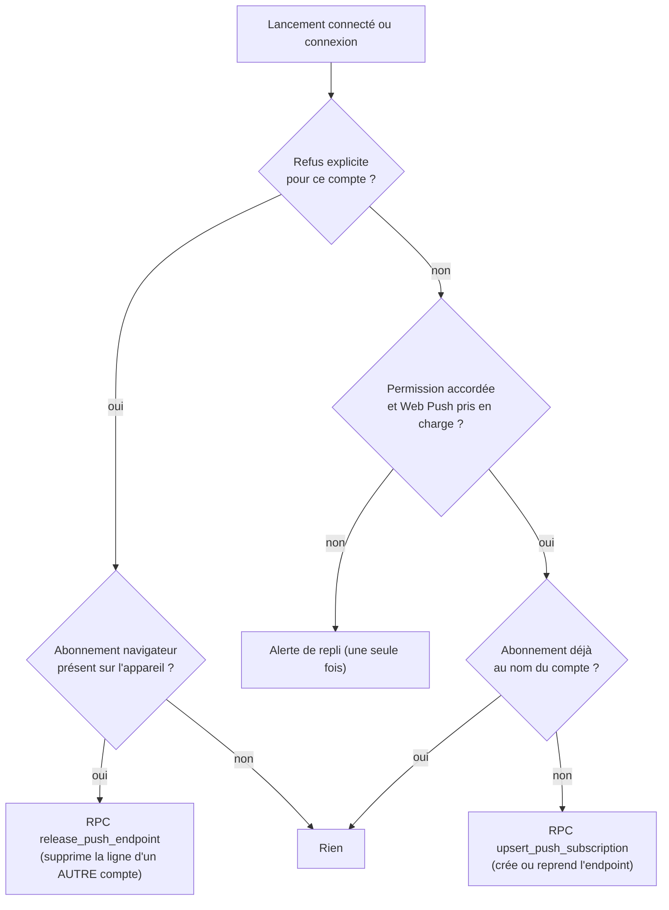
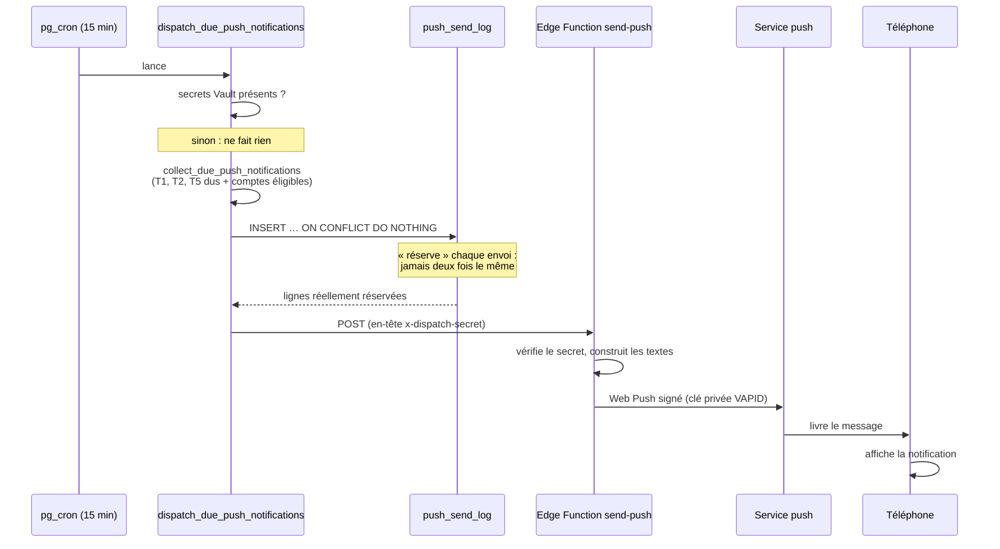
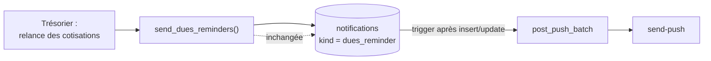
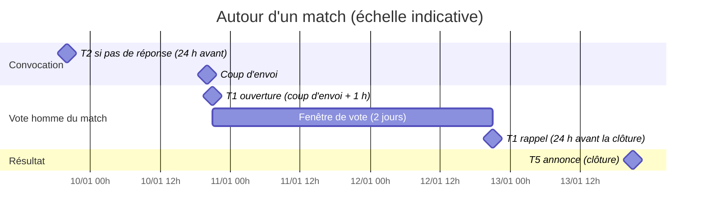
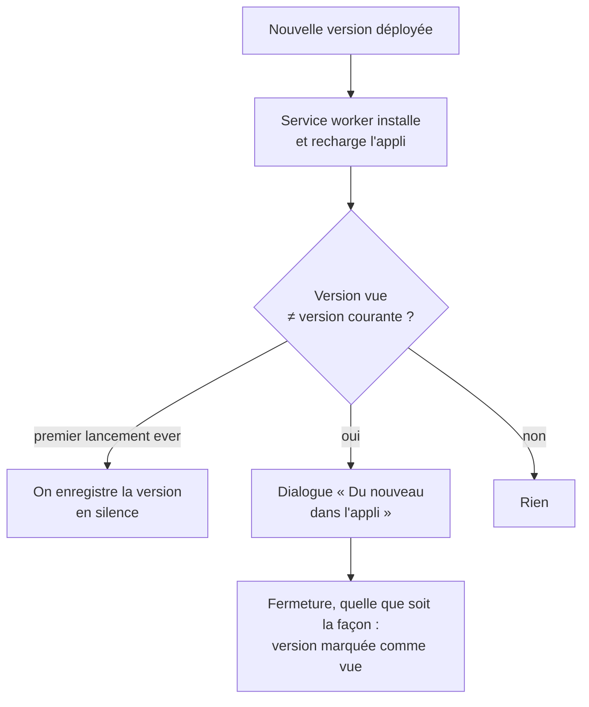

# Notifications — fonctionnement

> Document de référence pour le Bureau et les développeurs. Spec détaillée : `specs/mob-notifications.md`. Les schémas sont en Mermaid (rendus par GitHub).

## 1. En bref

L'application prévient les membres de **deux manières** :

| Canal | Où | Quand |
|---|---|---|
| **In-app** | Bandeaux et écrans déjà existants (rappel de vote, relance de cotisation, écran « Alertes » du coach) | Dès que l'on ouvre l'application |
| **Push** | Notification du téléphone, application fermée | Envoyée par le serveur, au bon moment |

Le push est un **complément** : il n'est jamais garanti (téléphone éteint, permission refusée…). L'in-app reste la source de vérité.

## 2. Les notifications

| # | Notification | Qui la reçoit | Quand | Canal |
|---|---|---|---|---|
| T1 | Rappel de vote « homme du match » | Joueurs de l'équipe n'ayant pas voté | À l'ouverture du vote (coup d'envoi + 1 h), puis 24 h avant la clôture — 2 au maximum | Push |
| T2 | Convocation sans réponse | Joueurs convoqués n'ayant pas répondu | 24 h avant un match ou une réunion, 12 h avant un entraînement | Push |
| T3 | Relance de cotisation | Le membre relancé par le trésorier | Au moment de la relance manuelle (sans montant dans le push) | Push |
| T4 | Mise à jour disponible + nouveautés | Tous | Au premier lancement après la mise à jour | In-app uniquement |
| T5 | Annonce de l'homme du match | Joueurs et coachs de l'équipe + tous les dirigeants habilités | Une fois le vote clos (coup d'envoi + 1 h + 2 jours), s'il y a au moins un vote | Push |

Ton : court, léger, au plus un emoji, jamais culpabilisant. Les textes sont définis à **un seul endroit** : `supabase/functions/_shared/push-messages.ts`.

## 3. Vue d'ensemble

## 4. Activer les notifications (côté téléphone)

Les notifications sont **activées par défaut** quand la permission du navigateur est déjà accordée (resynchronisation silencieuse ci-dessous). Sinon l'utilisateur active le switch dans **Menu → Paramètres → Notifications**. La permission du navigateur n'est demandée **qu'au toucher du switch**, jamais au lancement.

Les quatre états du switch : **activé**, **désactivé**, **refusé par le système** (à débloquer dans les réglages du téléphone), **non pris en charge** (iPhone hors application installée sur l'écran d'accueil, iOS 16.4 minimum).

### Déconnexion : l'abonnement est conservé

Principe : **un téléphone = un utilisateur**. La déconnexion **ne supprime pas** l'abonnement de l'appareil et ne change ni la préférence ni le refus explicite. Les notifications **continuent d'arriver** après une déconnexion (le « i » de l'écran Paramètres le dit : « Elles continuent d'arriver même si tu te déconnectes. Pour les arrêter, désactive-les ici. »). Un abonnement expiré (réponse 404/410 du service push) est supprimé automatiquement.

⚠️ Note écran verrouillé : après une déconnexion, des rappels (convocation, vote), le signal de relance de cotisation (sans montant) et le nom du lauréat (T5) peuvent s'afficher sur l'écran verrouillé. Si le téléphone change de mains sans désactivation, ces notifications atteignent un tiers. Mesures : information dans le « i », arrêt de tout envoi à la désactivation du compte, reprise ou libération de l'appareil à la connexion d'un autre compte. À valider par le référent RGPD (PO-NT-32).

### Resynchronisation silencieuse (à chaque lancement connecté et à chaque connexion)

Sans fenêtre ni clic : si la permission est **déjà accordée**, que le Web Push est pris en charge et qu'**aucun refus explicite** n'est mémorisé pour ce compte sur l'appareil, l'abonnement existe et appartient au compte connecté à l'issue du lancement. Il est créé s'il manque, **repris** s'il appartient à un autre compte, inchangé sinon. Aucune limite de nombre (idempotent : pas de doublon). La limite « une fois » ne vaut que pour l'alerte de repli de la fenêtre « Nouveautés ». Cette règle ne demande jamais la permission.

Le **refus explicite** (désactivation dans Paramètres, mémorisé par compte sur l'appareil, conservé à la déconnexion) est **toujours prioritaire** : jamais de réabonnement tant qu'il existe. Si ce compte se connecte sur un appareil encore rattaché à **un autre** compte, l'appareil est **libéré** (ligne supprimée côté serveur, le compte connecté n'est pas abonné) : l'ancien compte ne reçoit plus ses push sur ce téléphone (PO-NT-34).

Les deux écritures sur la ligne d'un autre compte passent par des fonctions `security definer` (`upsert_push_subscription` pour la reprise, `release_push_endpoint` pour la libération), car la RLS « propre ligne » ne le permet pas. L'appelant vient toujours de `auth.uid()`, jamais d'un paramètre, et rien n'est renvoyé sur le compte précédent.

## 5. Envoyer un push (côté serveur)

Toutes les 15 minutes, le serveur cherche ce qui est dû.

### Pas de doublon

Le journal `push_send_log` a pour clé `(compte, déclencheur, convocation, étape)`. La **réservation avant l'envoi** garantit qu'une personne reçoit chaque push **au plus une fois**, même si deux exécutions se chevauchent. Contrepartie assumée : si l'envoi échoue après la réservation, il n'est pas rejoué (l'in-app prend le relais).

### Pas de rattrapage

Pour T1, seule l'étape la **plus récente** échue est envoyée : un membre qui n'avait pas de push activé ne reçoit pas un rappel périmé en différé.

### Cas particulier : la relance de cotisation (T3)

Elle ne passe pas par le cron. Un **trigger** sur la table `notifications` réagit à la relance déjà écrite par `send_dues_reminders` et envoie un push immédiat. Toute erreur est absorbée : un échec de push n'annule jamais la relance ni l'alerte in-app.

## 6. Quand part chaque push ? (chronologie d'un match)

Le cron passe toutes les 15 minutes : un push peut donc partir avec **jusqu'à 15 minutes de retard** sur l'horaire théorique.

## 7. Mise à jour de l'application (T4)

L'application reste en mise à jour **automatique** (`autoUpdate`) : la nouvelle version s'installe et recharge toute seule. Il n'y a donc pas d'état « mise à jour en attente » à annoncer avant coup.

Les nouveautés viennent du `CHANGELOG.md` embarqué dans la nouvelle version (section « Mobile »). Une version sans section « Mobile » n'est pas annoncée. Le marqueur « dernière version vue » est stocké dans le `localStorage` de l'appareil.

## 8. Qui voit quoi (sécurité et vie privée)

| Élément | Règle |
|---|---|
| `push_subscriptions` | Chaque compte ne voit et ne supprime que **ses** appareils (RLS « propre ligne », administrateur compris). Reprise et libération d'un `endpoint` d'un autre compte : uniquement via `upsert_push_subscription` / `release_push_endpoint` (`security definer`). Les clés `p256dh` / `auth` ne reviennent **jamais** au client |
| `push_send_log` | Aucune politique pour les utilisateurs : lu et écrit uniquement par les fonctions serveur |
| Clé VAPID privée | Secret de l'Edge Function uniquement — **jamais** dans une variable `VITE_` |
| Appel du cron → Edge Function | Authentifié par un secret partagé (`x-dispatch-secret`), stocké dans Vault |
| Contenu du push | Aucun montant (T3), aucun nombre de voix ni identité de votant. Seul T5 nomme une personne (le ou les lauréats) |
| Journaux | Ni endpoint, ni contenu de push ne sont journalisés |
| Droits (RBAC) | Aucune nouvelle entrée dans la matrice : tout est calculé côté serveur à partir des rôles existants |

Les push transitent par les serveurs de Google, Apple ou Mozilla selon l'appareil.

## 9. Où est le code

| Couche | Fichiers principaux |
|---|---|
| Domain | `domain/policies/push-notification-schedule.ts` (règles T1, T2, T5), `push-notification-state.ts` (états du switch), `release-notes.ts` (T4), cas d'usage `Get/Enable/Disable/AutoEnablePushNotificationsUseCase` (resynchronisation silencieuse) |
| Data | `PushSubscriptionRepositoryImpl` (serveur), `PushDeviceRepositoryImpl` (navigateur) |
| Presentation | `features/settings/` (écran Paramètres), `features/whats-new/` (dialogue T4) |
| Service worker | `public/push-sw.js`, branché dans `vite.config.ts` via `importScripts` |
| Supabase | Migrations `push_notifications_schema`, `match_winners_refactor`, `push_dispatch`, `push_subscription_takeover` ; Edge Function `supabase/functions/send-push` ; textes dans `_shared/push-messages.ts` |

Les constantes (délais, fenêtres) existent côté TypeScript **et** côté SQL : elles sont recopiées à la main et commentées des deux côtés. À modifier ensemble.

## 10. Mise en service

Tant que ces étapes ne sont pas faites, le cron tourne mais **n'envoie rien** :

1. Générer la paire VAPID : `npx web-push generate-vapid-keys`.
2. Secrets de l'Edge Function : `VAPID_PUBLIC_KEY`, `VAPID_PRIVATE_KEY`, `VAPID_SUBJECT` (`mailto:…`), `PUSH_DISPATCH_SECRET`, et `CLUB_TIME_ZONE` en option (défaut `Europe/Paris`).
3. Déployer `send-push`.
4. Secrets Vault : `push_dispatch_url` (URL de la fonction) et `push_dispatch_secret` (même valeur que `PUSH_DISPATCH_SECRET`).
5. Définir `VITE_VAPID_PUBLIC_KEY` (clé **publique**) dans Netlify.

## 11. Rétention

Valeurs par défaut proposées, à confirmer avant la production (PO-NT-14) :

| Donnée | Durée |
|---|---|
| Abonnement push inutilisé | 6 mois |
| Journal d'envoi | 30 jours |

La purge est un job planifié côté Supabase (`purge-push-data`, tous les jours), jamais dans `domain/`. À reporter dans `docs/RETENTION_PURGE.md`.

## 12. Points encore ouverts

- **PO-NT-12 / PO-NT-26** : information RGPD (transit par des services tiers, push nommant le lauréat) — à traiter avec le référent RGPD, pas encore désigné.
- **PO-NT-14** : durées de rétention ci-dessus.
- **PO-NT-11 / PO-NT-25** : relecture des textes par le Bureau, tutoiement retenu (PO-NT-25 résolu).
- Un push de T1 ou T5 ouvre la convocation, pas directement l'onglet vote.
